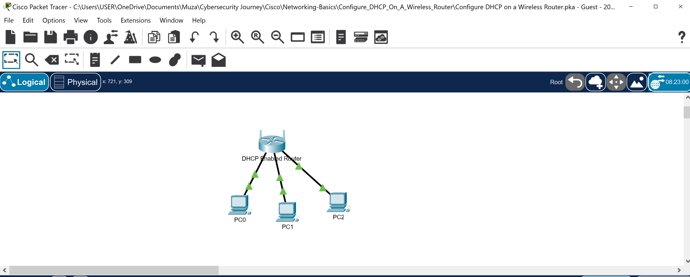
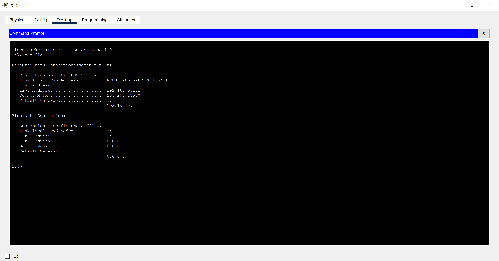
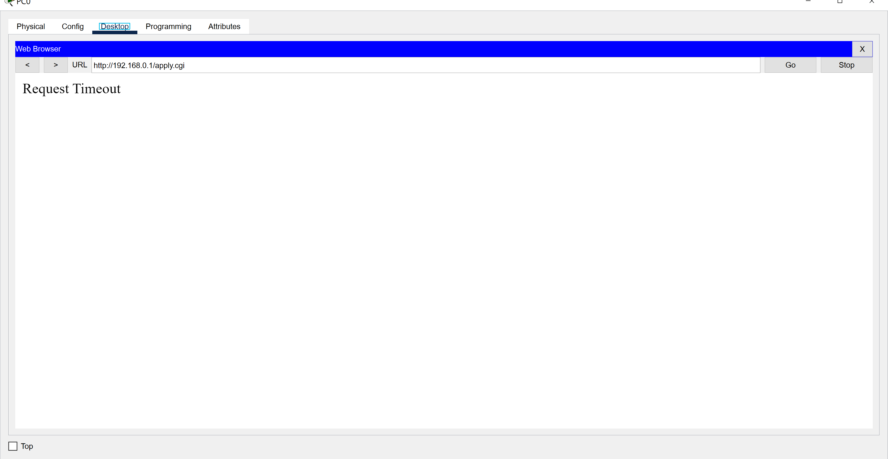
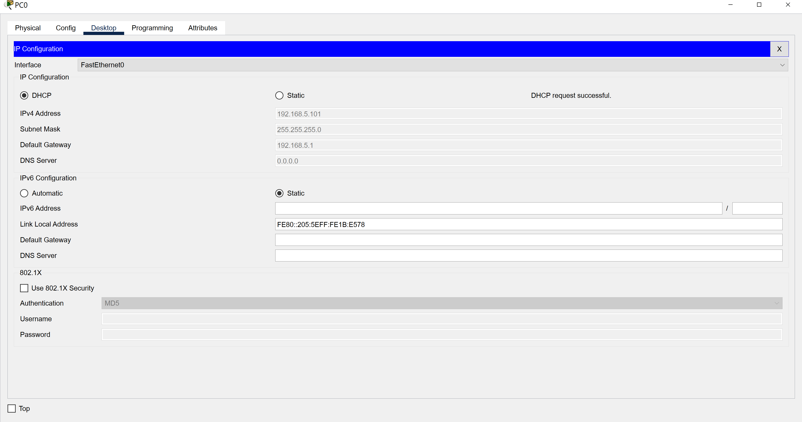
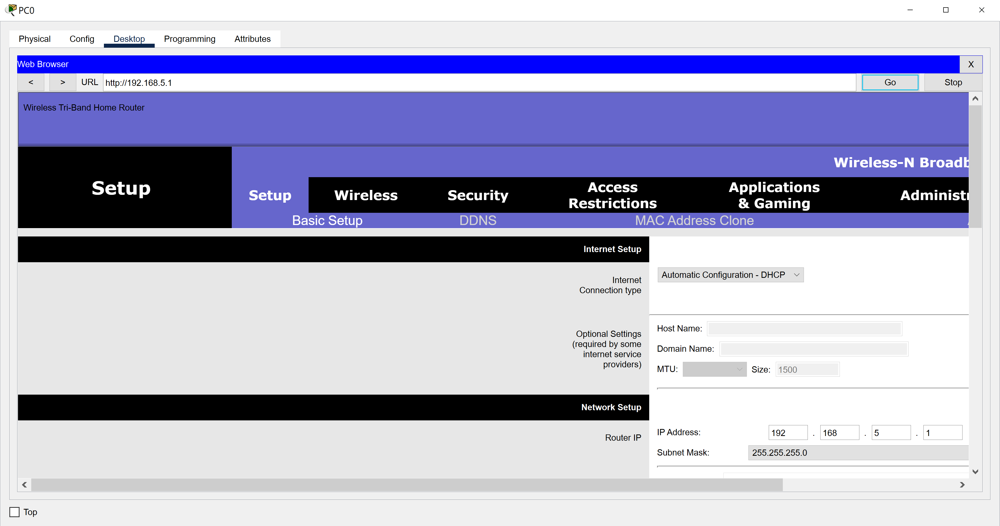

# Packet Tracer Activity Report: Configure DHCP on a Wireless Router

## Introduction

In this activity I set up a home network where three PCs get their IP addresses automatically from a wireless router. I also changed the router's own IP address and its DHCP address range, then checked that every device could still communicate.

## Part 1: Building the Topology

I added three PCs and connected each one to an Ethernet port on the wireless router with straight-through cables. I waited for the link lights to turn green before moving on.

## Part 2: Observing the Default DHCP Settings

On PC0, I set IP Configuration to DHCP and noted the default gateway: **[default gateway IP]**. I entered it in the web browser to open the router's setup page and looked at the default settings, including the router's IP address and the DHCP range available to clients.

## Part 3: Changing the Router's IP Address

On the router's setup page, I changed the router IP to **192.168.5.1** and saved. The page then showed an error, which is expected: the router's address changed, but PC0 still held an address from the old network. To fix this, I switched the PC's IP Configuration to Static and back to DHCP to renew its address, then opened the router at its new address.

## Part 4: Changing the DHCP Range

I changed the DHCP starting address to **192.168.5.126** and set the maximum number of users to **75**, which gives a pool of 192.168.5.126 to 192.168.5.200. After renewing the address, `ipconfig` on PC0 showed **[PC0 IP address]**.

## Part 5: Enabling DHCP on the Other PCs

I set PC1 and PC2 to DHCP. PC1 received **[PC1 IP address]** and PC2 received **[PC2 IP address]**.

## Part 6: Verifying Connectivity

From PC2, I ran `ipconfig` to confirm its settings, then pinged the router (192.168.5.1) and PC1. 

## Conclusion

This activity showed how a router's DHCP server hands out addresses, and how changing the router's network forces connected devices to renew their addresses before they can reach it again.

---

### 🔑 Key Concepts This Reinforced
- DHCP removes the need to configure each device by hand: the router assigns addresses automatically
- Changing a router's IP address changes its whole network, so clients must renew their leases to rejoin it
- The DHCP starting address plus the maximum number of users defines the address pool (126 + 75 users gives .126 to .200)
- Ping tests to the router and to another host confirm both local connectivity and correct addressing