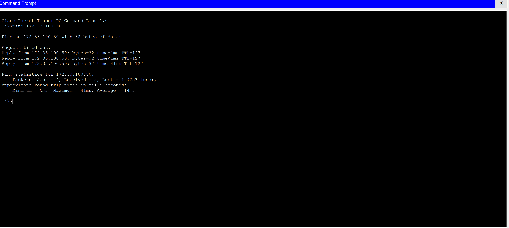
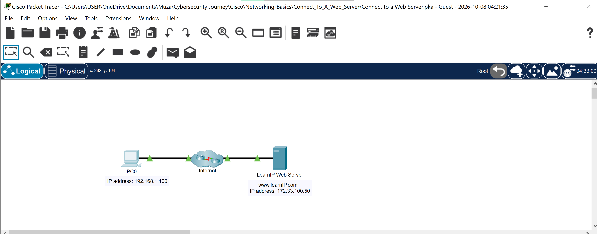

# Packet Tracer Activity Report: Connect to a Web Server

## Introduction

This activity showed how a device reaches a web server across a network using only its IP address. The goal was to first confirm that a client PC could communicate with the server, then open the server's web page from that same PC.

## Part 1: Verifying Connectivity to the Web Server

On PC0, I opened the Command Prompt from the Desktop tab and used `ping` against the web server's IP address, 172.33.100.50. A reply means packets can travel from the client to the server and back.

```
C:\>ping 172.33.100.50

Pinging 172.33.100.50 with 32 bytes of data:

Request timed out.
Reply from 172.33.100.50: bytes=32 time=1ms TTL=127
Reply from 172.33.100.50: bytes=32 time<1ms TTL=127
Reply from 172.33.100.50: bytes=32 time=41ms TTL=127

Ping statistics for 172.33.100.50:
    Packets: Sent = 4, Received = 3, Lost = 1 (25% loss),
Approximate round trip times in milli-seconds:
    Minimum = 0ms, Maximum = 41ms, Average = 14ms
```

The first request timed out and the remaining three succeeded, giving 25% packet loss. This is expected at the start of a connection: devices are still loading and ARP has to resolve the destination's address before the first packet can get through. Since the later replies came back normally, connectivity to the server was confirmed.



## Part 2: Connecting to the Web Server from the Web Browser

On PC0, I opened the Web Browser from the Desktop tab, entered `http://172.33.100.50` in the URL field, and clicked Go. The page loaded with the heading "Welcome to the Learn IP Web Site". The message on the page explained that I could reach the site because I had the web server's IP address, and because the PC had a web client (the browser) running on it.



## Conclusion

This activity confirmed that a client can reach a web server using only its IP address, as long as the client is running web client software. It also showed that ping is a quick first test of connectivity, and that a single timeout at the start doesn't mean the connection is broken.

---

### 🔑 Key Concepts This Reinforced
- Ping uses ICMP echo requests to test whether one device can reach another, which makes it a first diagnostic step in any network problem
- The first ping in a session can time out while ARP resolves addresses, so one lost packet doesn't necessarily mean a real fault
- Reaching a web page needs two things: the server's address and a web client on the requesting device
- The TTL of 127 in the replies shows the packets crossed a router on the way (the starting value was most likely 128)