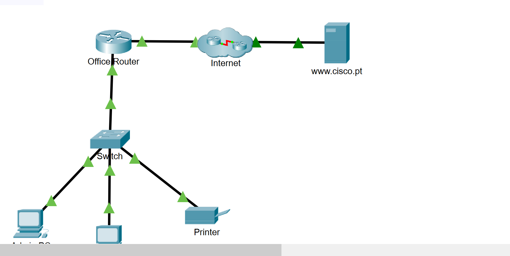
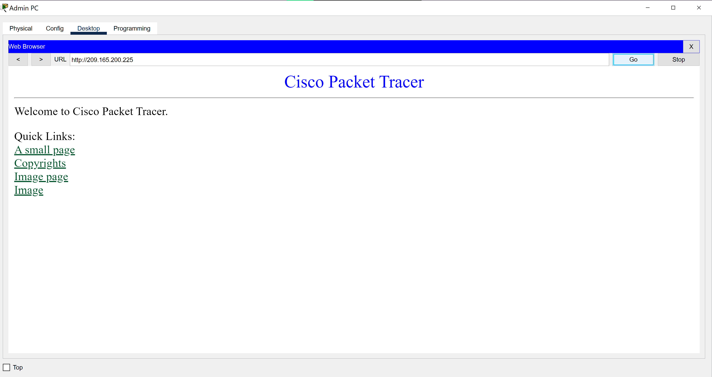
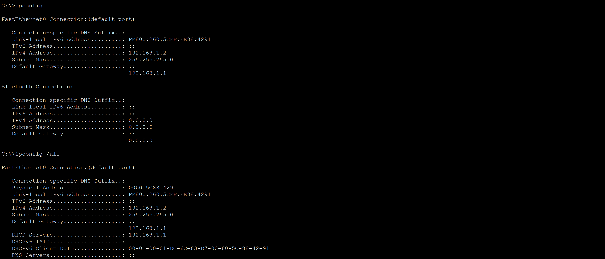

# Packet Tracer Activity Report: Create a LAN

## Introduction

In this activity I built the LAN for a new branch office. I connected the devices, set up IPv4 addressing, and tested connectivity to both local and remote resources.

## Part 1: Connecting the Devices

I powered on the end devices and the office router, then used copper straight-through cables to connect: the office router to the internet cloud and to the switch, the Admin PC and Manager PC to the switch, and the printer to the switch. I waited for green link lights on every connection.

## Part 2: IPv4 Addressing

The Admin PC and Manager PC were set to get addresses dynamically from the router's DHCP server. The printer was given a static address, **192.168.1.100 / 255.255.255.0**, so its address never changes. Printers and servers are usually given fixed addresses because other devices find them by IP.

## Part 3: Verifying Connectivity

I confirmed both PCs received addresses on the 192.168.1.0 network, then pinged the printer from each PC.I also opened the web browser and loaded the remote server first by its IP address and then by its URL, www.cisco.pt.

## Part 4: Networking Commands

I ran `ipconfig` and `ipconfig /all` on a PC to view its addressing details, then ran `tracert` to the web server to see the routers its packets pass through.

## Conclusion

This activity covered a full small-office LAN build: cabling, mixed dynamic and static addressing, and verifying connectivity with ping, a web browser, ipconfig, and tracert.

---

### 🔑 Key Concepts This Reinforced
- Hosts on the same network have different IP addresses but the same subnet mask and default gateway
- Servers and printers are given static addresses so other devices can always find them
- If a site loads by IP address but not by URL, the likely cause is a DNS problem, not a connectivity problem
- `ipconfig /all` shows more than `ipconfig`, including MAC address, DHCP server, and DNS servers
- `tracert` shows each router a packet passes on the way to its destination