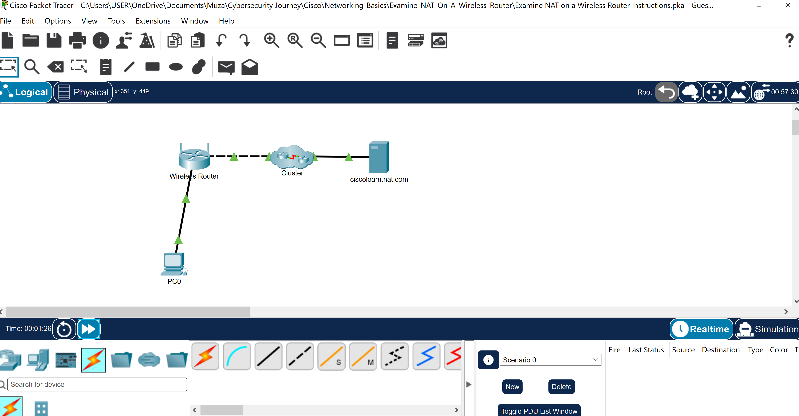
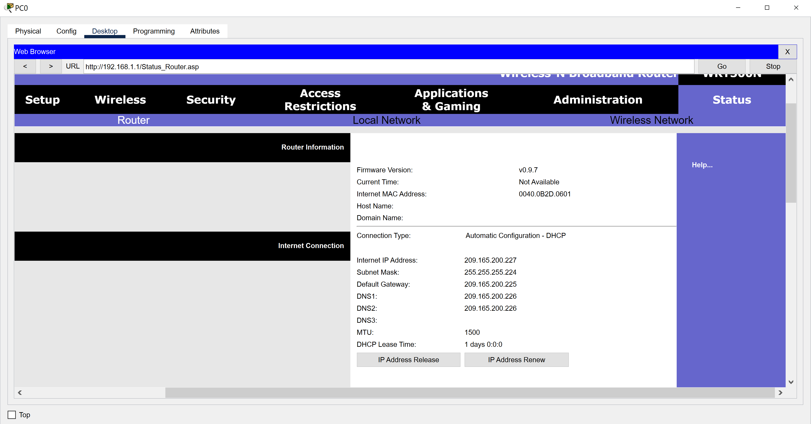
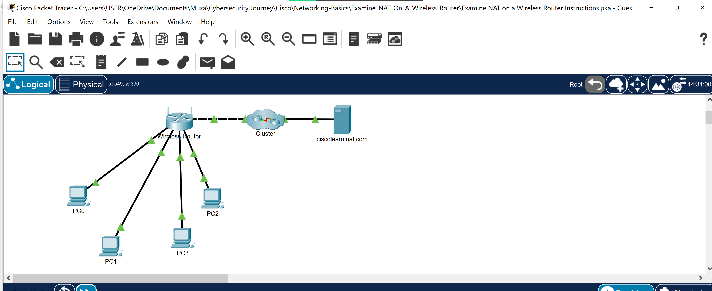
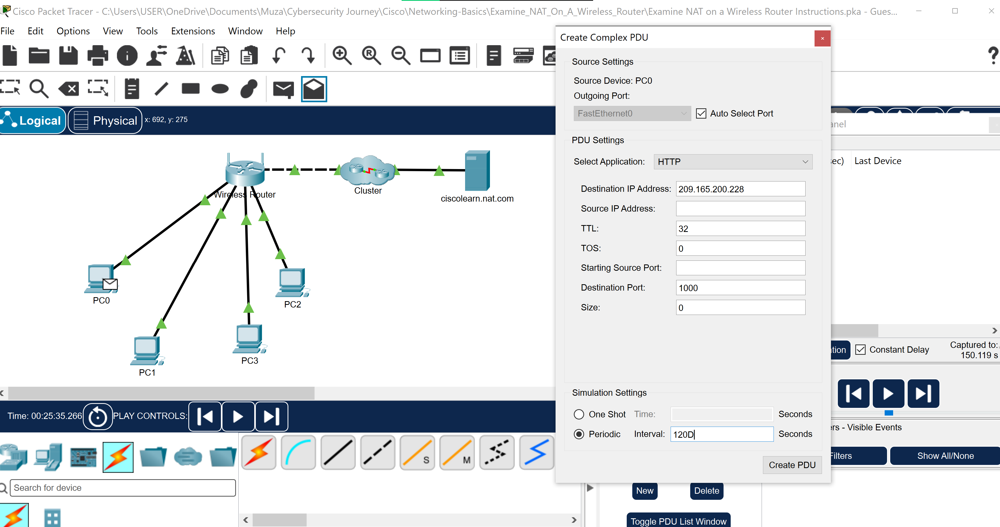
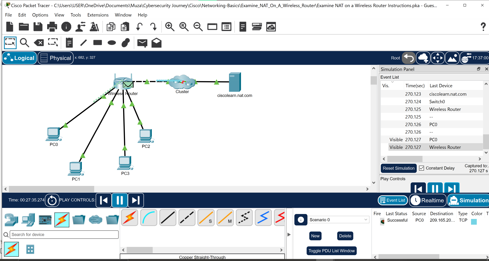
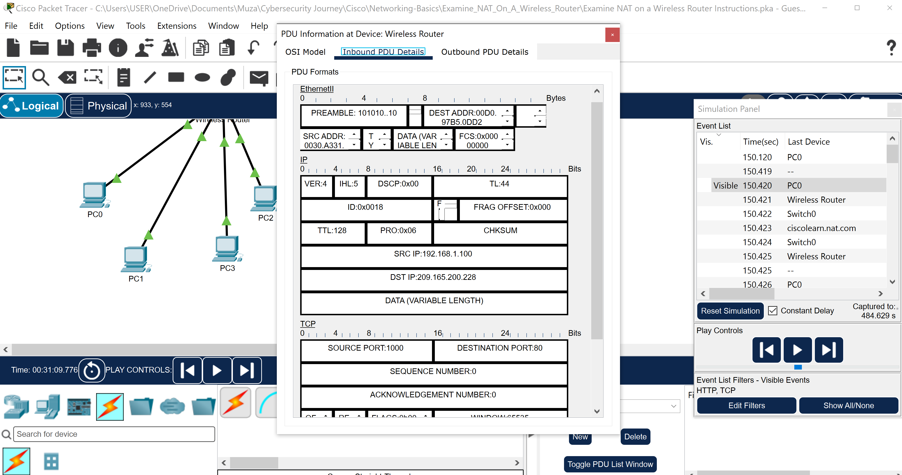

# Packet Tracer Activity Report: Examine NAT on a Wireless Router

## Introduction

This activity let me see Network Address Translation (NAT) in action on a wireless router. I looked at how the router connects to the outside network and the internal network, then watched packets cross the router and saw their addresses change.

## Part 1: The External Network Connection

I connected a PC to the wireless router, set it to DHCP, and opened the router's page using the default gateway address. On the Status page, the Internet Connection section showed the address given to the router by the ISP.

## Part 2: The Internal Network

On the Local Network page, I saw the router's internal address and the DHCP pool it hands out.

## Part 3: Connecting Three More PCs

I added three more PCs, connected them to the router, and set each to DHCP. I ran `ipconfig /all` on each to confirm they received private addresses. Private addresses can't cross the internet, so NAT has to translate them.

## Part 4: Viewing NAT in Simulation Mode

In Simulation mode, I filtered the events to TCP and HTTP and created a Complex PDU: an HTTP request from one of the PCs to the ciscolearn.nat.com server, with source port 1000, repeating every 120 seconds. I then played the simulation to watch the traffic.

## Part 5: Comparing Packet Headers

I opened one of the packets and compared the inbound and outbound PDU details. The source IP address changed as the packet passed through the router: **[inbound source IP]** became **[outbound source IP]**. This is NAT translating the PC's private address to the router's public address.

## Conclusion

This activity made NAT concrete by showing the source address of the same packet before and after it passes through the router.

---

### 🔑 Key Concepts This Reinforced
- Private addresses can't be routed on the internet, so NAT translates them to the router's public address
- A home router has two sides: a public-facing address from the ISP and a private internal network
- Comparing a packet's source address before and after the router shows exactly where NAT happens
- Simulation mode is a useful way to inspect individual packets and see what happens in each step