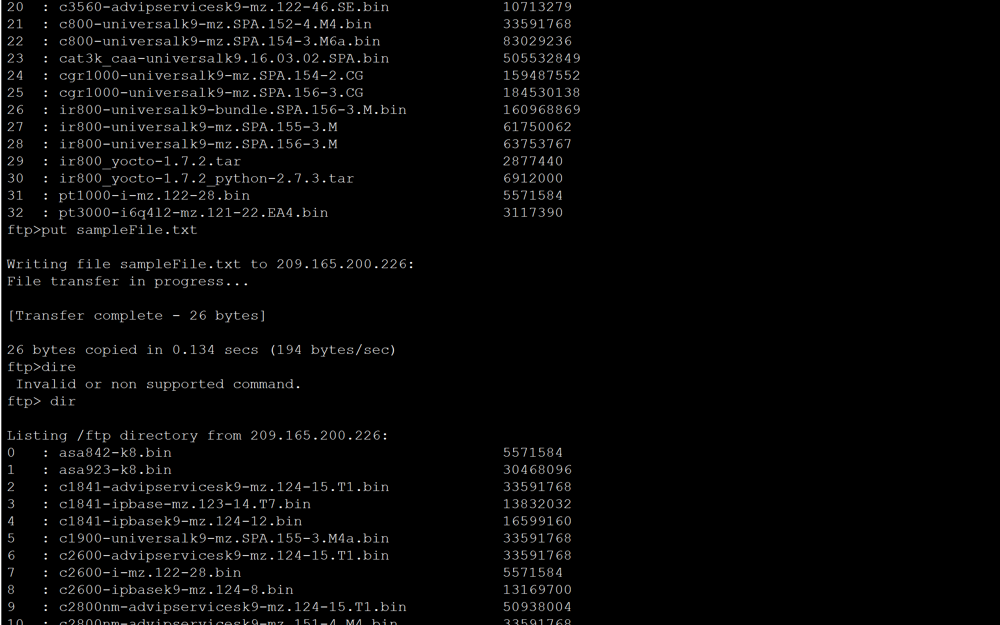
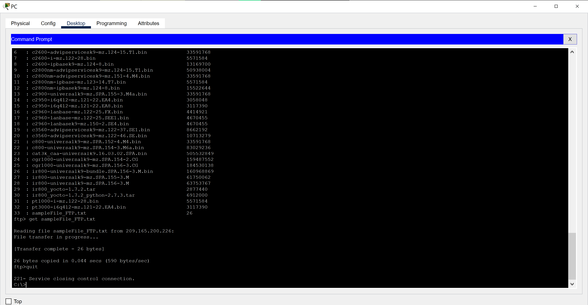
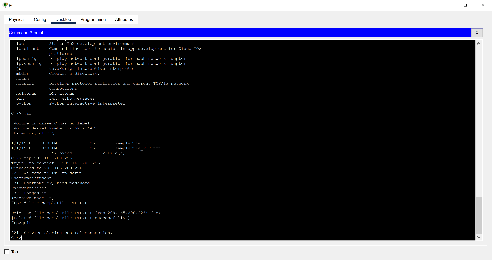

# Packet Tracer Activity Report: Use FTP Services

## Introduction

File Transfer Protocol (FTP) is a standard way to move files between a client and a server. FTP uses port 21 for commands and port 20 for data transfer. In this activity, I uploaded a file to an FTP server and then downloaded one from it.

## Part 1: Uploading a File to the FTP Server

On PC-A, I opened the Command Prompt and used `dir` to find `sampleFile.txt` in the C: directory. I connected to the FTP server (209.165.200.226) with `ftp`, and logged in using the credentials provided by the lab. At the `ftp>` prompt, I listed the server's files with `dir`, uploaded the file with `put sampleFile.txt`, and ran `dir` again to confirm it was there.

```
ftp> put sampleFile.txt
[Transfer complete - 26 bytes]
```



## Part 2: Downloading a File from the FTP Server

I renamed the file on the server with `rename sampleFile.txt sampleFile_FTP.txt` and checked with `dir`. Then I downloaded it with `get sampleFile_FTP.txt`, quit the FTP client, and listed the PC's directory to confirm the file arrived.

```
ftp> get sampleFile_FTP.txt
[Transfer complete - 26 bytes]
```



## Deleting the File

I logged back in and used the `delete` command to remove `sampleFile_FTP.txt` from the server, then quit the client.



## Conclusion

This activity covered the full FTP workflow from the command line: connecting, listing, uploading, renaming, downloading, and deleting. These are the same commands used in real FTP sessions.

---

### 🔑 Key Concepts This Reinforced
- FTP uses two ports: 21 for commands and 20 for data transfer
- The main FTP commands are `dir` (list), `put` (upload), `get` (download), `rename`, and `delete`
- FTP sends data, including login details, in plain text, so it is not suitable for sensitive transfers (SFTP or FTPS are the secure alternatives)
- A clean `dir` listing before and after each action is a simple way to verify that a transfer worked