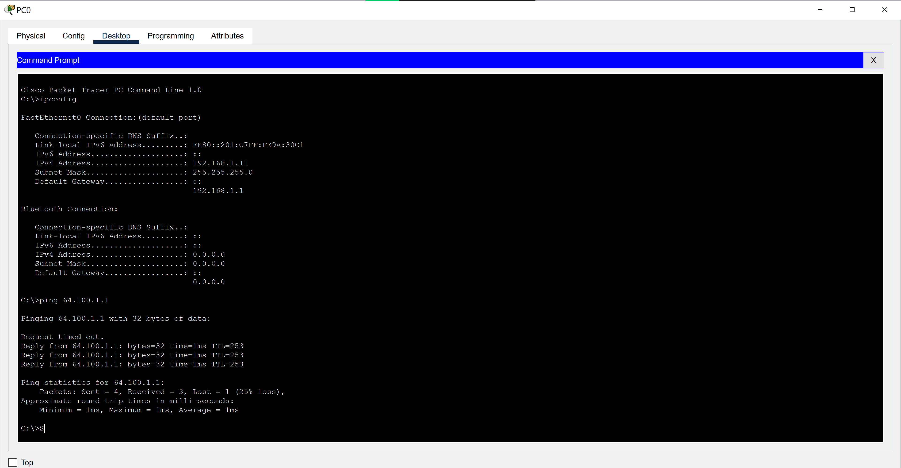
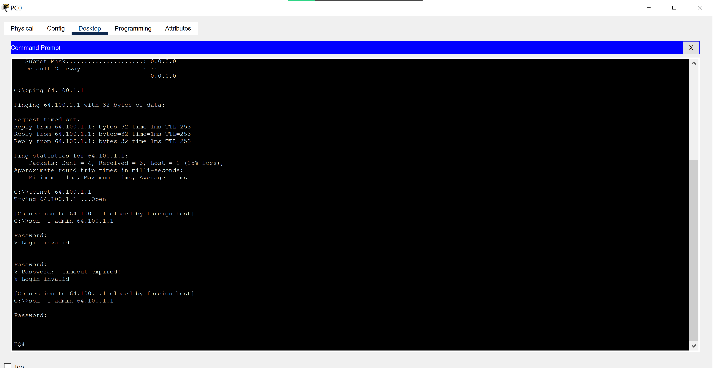

# Packet Tracer Activity Report: Use Telnet and SSH

## Introduction

In this activity I tried to open a remote connection to a router using two protocols: Telnet and SSH. The router, HQ (64.100.1.1), was configured to reject insecure access, which made the activity a practical comparison of the two.

## Part 1: Verifying Connectivity

On a PC, I opened the Command Prompt and ran `ipconfig` to confirm the PC had received an IP address from DHCP. I then pinged the router at 64.100.1.1 to verify it was reachable.

## Part 2: Accessing the Remote Router

**Telnet.** I ran `telnet 64.100.1.1`. **[Describe the output, for example that the connection was refused.]** The router was set up to block Telnet, which is correct behavior.

**SSH.** I then ran `ssh -l admin 64.100.1.1` and entered the password provided by the lab. The connection succeeded and the prompt changed to **[router prompt, for example `HQ>`]**, confirming I had reached the router remotely.

## Conclusion

This activity showed why SSH replaced Telnet for remote administration. Telnet sends everything in plain text, including passwords, so a well-configured router refuses it. SSH encrypts the whole session.

---

### 🔑 Key Concepts This Reinforced
- Telnet is unencrypted: anyone capturing the traffic can read usernames, passwords, and commands
- SSH encrypts the session, which is why secure devices disable Telnet and require SSH
- Verifying connectivity with `ipconfig` and `ping` comes before trying to connect remotely, because it separates network problems from access problems
- Disabling insecure protocols is a basic but important part of hardening network devices