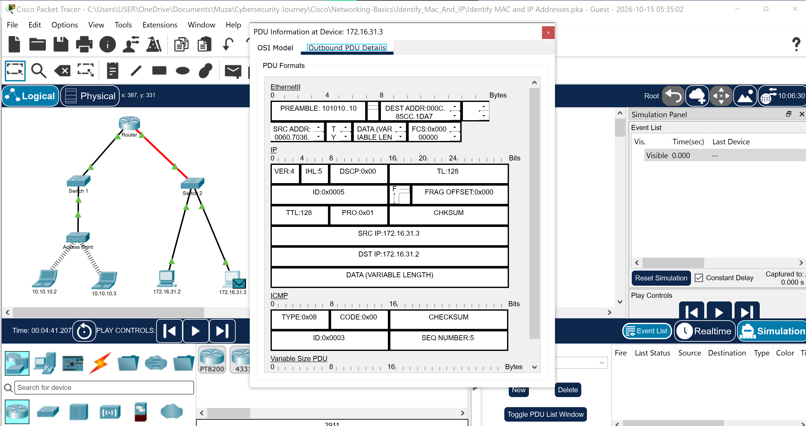
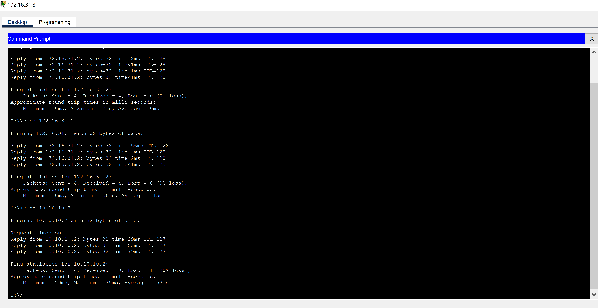
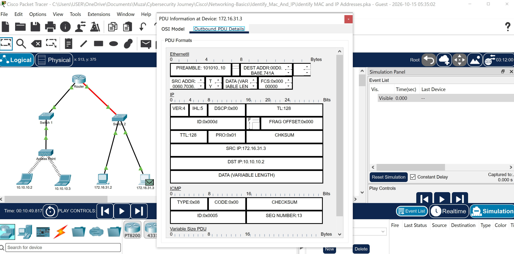

# Packet Tracer Activity Report: Identify MAC and IP Addresses

## Introduction

In this activity I used Packet Tracer's simulation mode to follow data as it travels across a network. I inspected the Ethernet frames and IP packets at each step, focusing on how MAC addresses (Layer 2) and IP addresses (Layer 3) behave for local traffic versus traffic that leaves the local network. No device configuration was needed, only observation.

## Part 1: Local Network Communication

From host 172.16.31.3, I pinged another host on the same network (172.16.31.2). In simulation mode, I captured the PDU and stepped it through each device, recording the source and destination MAC and IPv4 addresses at every stop.

## Part 2: Remote Network Communication

Next I pinged 10.10.10.2, which is on a different network. The first ping or two timed out while the network resolved addresses. In simulation mode, I traced the PDU through the router and recorded the addressing at every step.

The destination MAC address on the first frame belonged to **[device and interface]**. This is the router's interface, the host's default gateway, even though the destination IP was on the remote network.

## Reflection

- **Media and devices:** **[the cable types and devices you saw, and whether the access point changed any addresses]**
- **Where the MACs changed:** the MAC addresses changed at the **[router]**, while the IP addresses stayed the same from source to destination
- **Why the router has two networks:** its interfaces sit on two different IP networks because its job is to connect them

## Conclusion

This activity made it clear that MAC addresses are rewritten at every hop, while IP addresses stay the same from source to destination.

---

### 🔑 Key Concepts This Reinforced
- For local traffic, the destination MAC is the actual destination device; for remote traffic, it is the router's interface (the default gateway)
- MAC addresses change at each router hop; source and destination IP addresses normally stay the same end to end
- Hosts only need a default gateway to communicate with devices on other networks
- Simulation mode shows exactly what happens to a packet at each device, which is a useful way to learn how traffic really flows